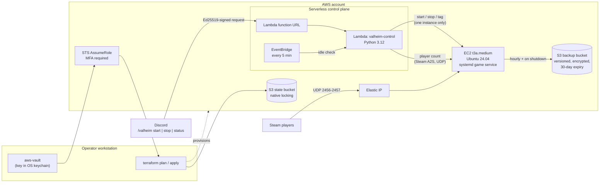

# Self-Service Valheim Server on AWS

A dedicated Valheim game server on AWS, defined entirely in Terraform. Friends start, stop, and check it with Discord slash commands. It shuts itself down after 30 minutes with no players and backs the world up to S3 hourly and on every shutdown.

I built it for a small private group, and it's been in real use since September 2026. The goal was to run something small the way I'd want production infrastructure run: everything in code, no standing admin credentials, least-privilege access, and backups that don't depend on someone remembering to take them.

## Architecture



## What it does

- **Infrastructure as code.** EC2, Elastic IP, security groups, IAM, S3, Lambda, and EventBridge are all in Terraform. A separate `bootstrap/` module creates the remote-state bucket, and lifecycle guards keep AMI updates and config drift from rebuilding the instance and destroying the world.
- **No ambient credentials.** Every deployment runs through an MFA-gated IAM role assumed with aws-vault. The only long-lived key can do exactly one thing: assume that role, with a fresh MFA code.
- **Self-service from Discord.** A Python Lambda handles `/valheim start`, `stop`, and `status`. It verifies Discord's Ed25519 request signature, accepts commands from one server only, and its IAM role can act on exactly one instance.
- **Pays only for play time.** A scheduled check counts live players over the Steam query protocol and stops the instance after 30 idle minutes. That keeps idle cost to about $7/month, compared with roughly $34/month running 24/7.
- **Backups that happen on their own.** World saves are copied hourly (only when they've changed) to a versioned, encrypted S3 bucket. A systemd stop hook also takes a backup on every graceful shutdown, so a Discord stop, an idle stop, and a reboot each leave a fresh snapshot. The restore procedure is documented in the runbook.
- **Locked-down access.** SSH is open only to my current public IP, detected automatically on every `terraform apply`, so a dynamic home connection never needs a manual rule change.

## Design decisions

| Decision | Why |
|---|---|
| MFA-gated deployer role via aws-vault | No admin credentials on disk. A bare `terraform` command has no access at all. |
| Separate `bootstrap/` module for the state bucket | A state bucket can't hold its own creation state. `prevent_destroy` keeps a stray destroy from wiping all project state. |
| Native S3 state locking, no DynamoDB | One fewer resource and permission set. Supported since Terraform 1.11. |
| `ignore_changes` on AMI, subnet, user data, and the idle tag | The world lives on the root volume, so a replacement would destroy it. Routine upstream changes must never force one. |
| Public Lambda function URL, no AWS auth | Discord can't sign AWS requests. Signature verification *is* the authentication, and the role's blast radius is one instance. |
| Idle stop fails safe | If the player count can't be read, the server stays up. Stopping a game under people is worse than paying for an extra hour. |
| Backups on systemd `ExecStopPost` | Ties a backup to every graceful shutdown, which is what makes automated stops safe. |
| cloud-init, not Ansible or Packer | One host with rarely changing config. At more than one server, I'd move configuration to Ansible or a Packer image. |
| On-demand, not Spot | Spot would save about $2/month at this usage, but a reclaim drops everyone mid-session. |
| Elastic IP kept while stopped | Friends join by a fixed address. Simplicity is worth about $3.60/month. |

## Lessons learned

The full list, with root causes and fixes, is in [`docs/troubleshooting.md`](docs/troubleshooting.md). The ones that taught me the most:

- **Vendor tooling can overwrite your customizations.** SteamCMD's `validate` step replaced my custom launch script in the install directory. The fix was to keep the script outside any directory the vendor tool manages.
- **Shell globs expand before `sudo` runs.** A cleanup command quietly matched nothing, because the calling user couldn't read the target directory. No globs under `sudo`; use exact paths or `sudo sh -c`.
- **A public Lambda function URL needs two resource-policy grants.** With only one, every request gets a generic `Forbidden` that doesn't say which piece is missing.
- **Client and server versions have to match when a world is generated.** A version gap during world generation is the suspected cause of missing vegetation, so the world was regenerated with matched versions.

## Repository layout

```
.
├── main.tf, variables.tf, outputs.tf   EC2, networking, Elastic IP, inputs, outputs
├── backup.tf                           backup bucket and instance role
├── discord.tf                          control Lambda, function URL, EventBridge schedule
├── user_data.sh.tpl                    cloud-init: SteamCMD, systemd service, update script
├── scripts/install-backup.sh           idempotent backup installer (cron + stop hook)
├── discord/
│   ├── lambda/handler.py               Discord commands and the idle check
│   ├── layer/build-layer.sh            builds the PyNaCl Lambda layer
│   ├── commands.json                   slash-command definition
│   └── register-commands.ps1           one-time command registration
├── bootstrap/                          creates the remote-state bucket
├── iam/                                deployer role trust and permission policies
└── docs/
    ├── runbook.md                      full operator guide
    ├── iam-setup.md                    one-time IAM, aws-vault, and MFA setup
    └── troubleshooting.md              every real failure, with root cause and fix
```

## Deploying it

You'll need Terraform 1.11 or later, aws-vault, an AWS account, Python 3 with pip, and an SSH key pair. The short version:

1. **Store an admin credential in aws-vault** for the one-time setup. ([`docs/runbook.md`](docs/runbook.md#0-aws-vault-and-the-admin-credential-once))
2. **Create the state bucket:** `cd bootstrap`, copy `terraform.tfvars.example` to `terraform.tfvars`, then `aws-vault exec admin -- terraform init` and `apply`.
3. **Create the deployer role and caller user** by following [`docs/iam-setup.md`](docs/iam-setup.md), then remove the admin key from aws-vault.
4. **Build the Lambda layer:** `bash discord/layer/build-layer.sh`.
5. **Deploy the server:** copy `terraform.tfvars.example` to `terraform.tfvars`, fill it in, then run `aws-vault exec terraform-deployer -- terraform init` and `apply`.
6. **Set up Discord control** by following the [Discord section of the runbook](docs/runbook.md#one-time-discord-setup).

Every value that identifies a real account (account ID, bucket names, Discord IDs, passwords) is a `REPLACE_ME_*` placeholder or a variable. `terraform.tfvars` and all state files are gitignored.

## Known limitations

- The world lives on the root EBS volume, so destroying or replacing the instance deletes it. The S3 backups are the safety net.
- Valheim server updates are a manual `sudo valheim-update`, by design, to avoid surprise restarts mid-session.
- Steam players only. Console crossplay would require switching from join-by-IP to join codes.

## What I'd add next

- **A CI pipeline** that runs `terraform fmt`, `validate`, and `plan` on every pull request and `apply` on merge, using GitHub OIDC to assume an AWS role with no stored keys.
- **SSM Session Manager** in place of SSH, which removes port 22 and the IP lookup entirely.
- **A separate EBS volume** for world data, so the instance becomes disposable.
- **A CloudWatch billing alarm** as a backstop on cost.

## Tech

AWS (EC2, S3, IAM, STS, Lambda, EventBridge, CloudWatch) · Terraform · Python · Bash · PowerShell · systemd · cloud-init · aws-vault · Discord API
